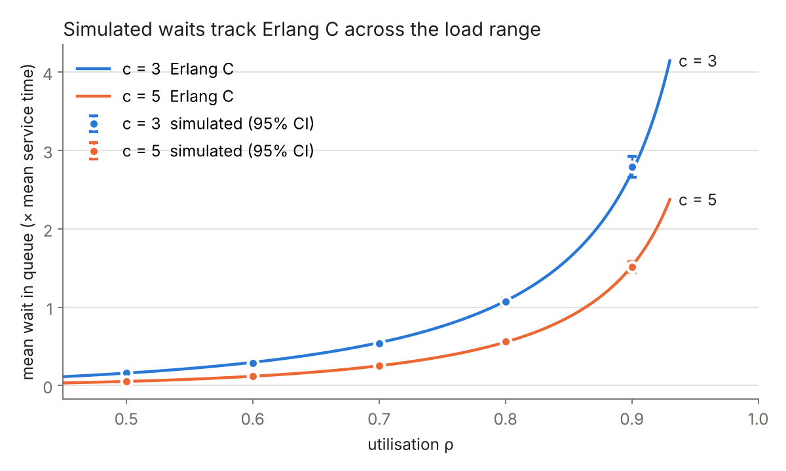

# EV Depot Sim

**How many chargers does a depot for 50 electric delivery vans need, and when do extra chargers stop helping?**

A discrete-event simulation of an EV fleet charging depot in Python and [SimPy](https://simpy.readthedocs.io/). The charging engine is validated against the exact M/M/c queueing result (Erlang C) before it is used for anything else.

## One engine, two modes, and why

The realistic depot is **not** an M/M/c queue. Vans run fixed shift schedules rather than Poisson arrivals. The fleet is finite (50 vans, not an infinite population). A 400 kW site power cap couples the chargers. Charge times depend on how far each van drove. Erlang C does not describe that system, and a model that matched it would be suspicious.

So the same charger/queue machinery (`ChargerBank` in `model.py`) runs in two modes:

| Mode | Arrivals | Service | Queue | Ground truth |
|---|---|---|---|---|
| `validation` | Poisson (exponential gaps) | exponential | FCFS, unlimited, no power cap | Erlang C, exactly |
| `depot` | 50 vans returning from shifts | energy to full ÷ charger power | FCFS or priority policy, 400 kW cap | none: this is the model |

The engine is validated where the theory holds, then used where it does not. Comparing the depot mode to Erlang C would fail by design, and that failure would say nothing about whether the code is correct.

## Validation result

The simulated mean wait in queue is within **0.36%** of Erlang C at all four load points. The analytical value lies **inside the 95% confidence interval at every point**.

| Chargers c | Utilisation ρ | Wq Erlang C | Wq simulated (95% CI) | Error | P(wait) theory / sim |
|---|---|---|---|---|---|
| 3 | 0.6 | 0.2956 | 0.2967 ± 0.0019 | +0.36% | 0.3547 / 0.3549 |
| 3 | 0.8 | 1.0787 | 1.0806 ± 0.0079 | +0.18% | 0.6472 / 0.6477 |
| 5 | 0.6 | 0.1181 | 0.1178 ± 0.0007 | −0.27% | 0.2362 / 0.2360 |
| 5 | 0.8 | 0.5541 | 0.5524 ± 0.0035 | −0.31% | 0.5541 / 0.5535 |

Waits are in units of the mean service time (μ = 1). Simulated utilisation matches ρ to within 0.05%.



**How the intervals are built** (`runner.py`):

- **Replications:** 30 independent runs per point. Each run has its own `numpy.random.Generator` seeded 0–29 and passed in explicitly. Nothing touches global random state.
- **Run length:** each run lasts 200,000 time units. The first 20,000 are discarded, because the queue starts empty and early waits are biased low. Doubling the warm-up to 40,000 moves the estimate from 0.5524 to 0.5528, well inside the interval (see the notebook).
- **Sample:** one mean per run. Jobs within a run are correlated, so pooling every job into one mean would understate the uncertainty.
- **Interval:** the CI uses Student's t with 29 degrees of freedom, not 1.96. Half-widths are 0.6–0.7% of the mean.

The fixed seeds make the test deterministic. A 95% interval still misses the true value about 5% of the time, so across four points some seed sets will produce a near miss. The fast CI suite uses short runs and only 10 replications, so it checks coverage at 2 half-widths. The strict 95% coverage check runs at full length (`pytest -m slow`).

## Depot mode

**Defaults:**

- **Fleet:** 50 vans with 75 kWh batteries using 0.25 kWh/km. Daily routes are uniform between 80 and 200 km.
- **Shifts:** departure is uniform between 06:00 and 09:00, and shifts last 8–10 h.
- **Chargers:** 5 × 50 kW under a 400 kW site cap, served first come, first served.
- **Charging rule:** each evening a van queues for a charger, then for site power, then charges until it is full or it has to leave.
- **Readiness:** a van is "ready on time" if it leaves with enough charge for its next route plus a 10% reserve.

**Output for 30 runs of 15 days, with day 0 discarded:**

| Metric | Mean ± 95% CI |
|---|---|
| Mean wait from return to start of charging | 1.47 ± 0.03 h |
| 95th percentile wait | 3.11 ± 0.05 h |
| Charger utilisation (over 24 h) | 29.2% |
| On-time departures | 100% |
| Peak site power | 250 kW |
| Energy delivered per day | 1,750 ± 7 kWh |

**What it already shows:** with 50 kW chargers, the 400 kW cap lets only 8 vans draw power at once. A 9th through 12th charger adds hardware but no throughput: waits at 12 chargers equal those at 8 (`test_sensitivity.py`). Five chargers already get every van out on time with the default routes. Phase 3 will find where that breaks.

The policies (FCFS, lowest state of charge first, earliest departure first) are implemented. Comparing them is phase 3 work.

## How the depot model is checked

There is no closed form for the depot, so it is held to invariants instead. Each test compares quantities recorded by separate code paths (`test_conservation.py`):

- Energy metered at the site meter = energy booked per charging session = the gain in each battery's state of charge.
- Fleet energy balance: starting energy + energy charged − energy driven = final energy.
- Peak site power never exceeds 400 kW. A control test shows the cap actually binds at 12 chargers, and that the same fleet exceeds 400 kW with no cap, so the check is not vacuous.
- Per-charger utilisation is between 0 and 1. No charger is ever double-booked, which is checked by rebuilding occupancy from the session records.
- State of charge stays between 0 and 1. This test caught a stranded van ending at −2.8×10⁻¹⁷, which is now fixed.

To confirm these tests constrain something, four bugs were planted one at a time. Each was caught:

| Planted bug | Tests failing |
|---|---|
| Power cap not enforced | 2 |
| 2% overcharge per session | 10 |
| Trip energy capped at 40 kWh | 5 |
| Charger id not returned to the pool | 32 |

Directional checks (`test_sensitivity.py`) use common random numbers:

- More chargers reduce waits when power is not binding.
- Longer routes raise energy use and lower on-time departures.
- Doubling charger power halves charge time.

## Simplifications

These are deliberate in version 1 and stated rather than hidden:

- **Linear charging at constant power.** Real chargers taper above roughly 80% SoC, so charge times here are optimistic near full.
- **A van is unplugged as soon as it is full,** freeing the charger. In practice someone has to move it.
- **One depot and one van type.** No electricity prices or time-of-use tariffs, no battery degradation, no charger failures.
- **No road network or traffic.** Each route is a sampled distance with energy use proportional to it.
- **The site cap is a hard limit with whole-charger allocation.** There is no dynamic load balancing that splits power across vans.

## Run it

```bash
pip install -e ".[dev]"
```

```bash
pytest -m "not slow"
```

```bash
pytest -m slow
```

```bash
jupyter nbconvert --to notebook --execute notebooks/01_validation.ipynb
```

The fast suite takes about 10 s. The full Erlang C gate takes about 2.5 min on 4 cores.

```python
from depot_sim.config import DepotConfig
from depot_sim.runner import run_replications, summarise

runs = run_replications(DepotConfig(n_chargers=4, policy="lowest_soc"), n_runs=30, n_jobs=4)
print(summarise(runs, "on_time"), summarise(runs, "mean_wait"))
```

## Layout

```
src/depot_sim/
  config.py     all parameters and defaults (ValidationConfig, DepotConfig)
  theory.py     Erlang B (recursive), Erlang C, Wq, Lq, W
  model.py      ChargerBank; run_validation (M/M/c); run_depot
  policies.py   fcfs, lowest_soc, earliest_departure
  metrics.py    per-charger busy time, per-run summaries
  runner.py     seeded replications, t-based confidence intervals
tests/          theory, validation gate, conservation, sensitivity
notebooks/      01_validation.ipynb
results/        validation grid (CSV) and chart
```

## Next

- Phase 3: sweep the charger count and compare the three policies under tighter conditions (longer routes, 22 kW AC chargers), ending in a sizing recommendation.
- Phase 4: a Streamlit dashboard.
- Extensions: charging taper, time-of-use tariffs, a SUMO-driven route energy model.
